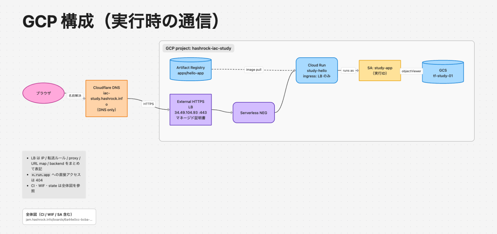

# 202610-study-iac

GCP + Terraform の学習用リポジトリ。

## 構成図

### GCP 構成（実行時の通信）

元ボード: https://jam.hashrock.info/boards/c2e43196-0063-4601-90d8-a7ea49e9b35b

### 全体図（CI / WIF / SA を含む）

https://jam.hashrock.info/boards/6a44e0cc-bcba-4a1f-9113-0af04e5ad014

## ディレクトリ

| ディレクトリ | 内容 | apply |
|---|---|---|
| `00-tfstate/` | Terraform state 用 GCS バケット | 手動（ローカル state） |
| `04-github-wif/` | GitHub Actions 用 Workload Identity Federation と SA | 手動 |
| `app/` | Artifact Registry / Cloud Run / GCS / SA など | CI（main への push） |
| `hello-app/` | Cloud Run で動かす Node.js アプリ | CI（`hello-app/**` の変更時） |

## CI

- `terraform.yml`: PR で plan、main への push で plan → `apply tfplan`
- `deploy-hello-app.yml`: イメージを build して Artifact Registry に push し、Cloud Run にデプロイ

GCP への認証は WIF のみで、SA 鍵は使っていない。
